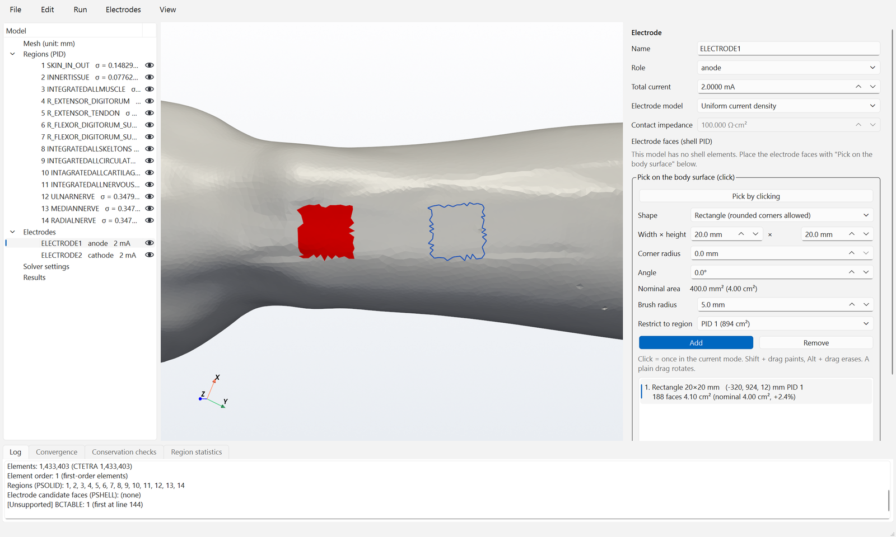
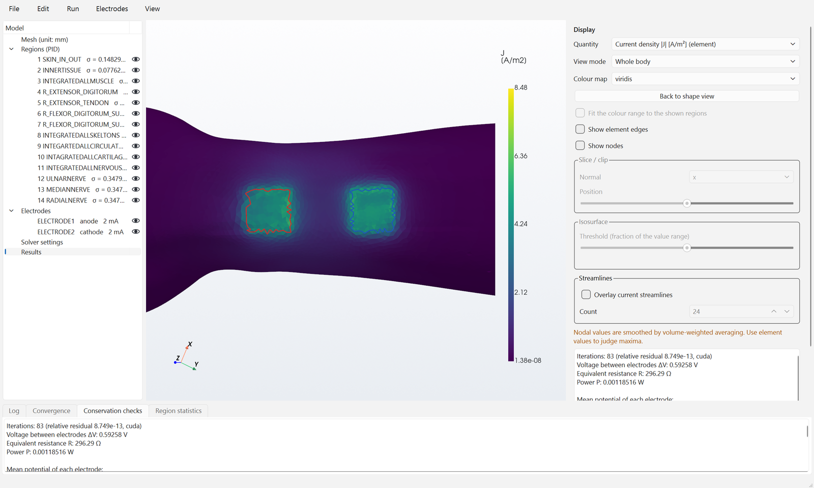
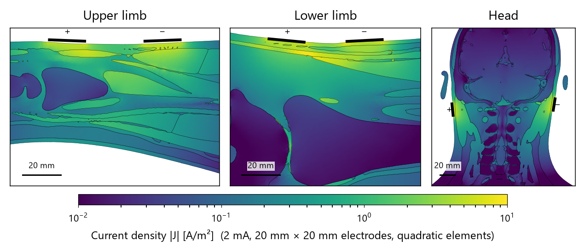

# FacetSetFEM

[English](README.md) | 日本語

経皮電気刺激（transcutaneous electrical stimulation）で体の中を流れる電流の分布を解析する、
有限要素法シミュレーションアプリケーション。
**電極は体表面の要素の面の集まりとして境界条件で与える**ので、メッシュを作り直さずに、
任意の部位・位置・形の電極を GUI のクリックで置いて解ける。



## 特長

- **メッシュを作り直さずに電極を置ける。** 3D ビューで体表面をクリックすると、その周りの要素の面が電極になる
  （円・角丸の矩形。筆で 1 枚ずつ足したり外したりもできる）。シェル要素で電極を作り込んだメッシュもそのまま使える
- **人体モデルをそのまま読める。** Nastran のバルクデータ（ScanIP などの書き出し）を読み込み、単位は SI に正規化する。
  四面体（1 次・2 次）・六面体・五面体に対応
- **2 つの電極モデル。** 一様電流密度（既定）と、接触インピーダンス付きの完全電極モデル（電流が電極の縁に集まる様子が出る）
- **速くて、どの計算機でも同じ答え。** 前処理付き共役勾配法（Jacobi / 代数マルチグリッド）を、CPU 逐次・CPU 並列・
  CUDA の GPU で実行でき、**3 つの答えはビット単位で一致する**。1000 万節点を GPU で約 11 秒で解く
- **解析解で検証済み。** 5 つの解析解との比較とメッシュ収束次数を回帰テストで確かめ、電流保存などの保存則は毎回自動で検査する
- **GUI と Python API。** 同じコアを GUI からも Python からも呼べるので、パラメータスタディ（電極の位置・導電率・電流を振る）を
  スクリプトで回せる。結果は VTU（ParaView）・CSV・実行の来歴（入力のハッシュ・Git の状態）つき JSON に書き出せる
- **英語と日本語の表示。**

|  |  |
|---|---|
|  |  |
| 解いた結果（体表面の電流密度 \|J\|） | 電極の真下を通る断面の \|J\|（上肢・下肢・頭部。2 mA、20 mm 角の電極、2 次要素） |

画像の人体モデルについては末尾の「[画像について](#画像について)」を参照。

## インストール

### wheel から（Rust も CUDA Toolkit も要らない）

配布用の wheel（`facetsetfem-0.1.0-cp312-abi3-win_amd64.whl`。Python 3.12 以降で共通）を受け取ったら:

```bash
pip install facetsetfem-0.1.0-cp312-abi3-win_amd64.whl
python -m facetsetfem.gui
```

GUI に要るもの（PySide6・PyVista・pyvistaqt）も一緒に入る。GPU で解くには NVIDIA のドライバ
（Compute Capability 6.0 以上の GPU）が要る。GPU が無ければ自動で CPU で解く。
wheel の作り方は「[配布用 wheel の作成](#配布用-wheel-の作成)」。

### ソースから

Rust（1.97 以降）と Python（3.12 以降）を用意して:

```bash
git clone https://github.com/t-ota0407/FacetSetFEM.git
cd FacetSetFEM
python -m venv .venv
.venv/Scripts/python.exe -m pip install -r requirements.txt
.venv/Scripts/maturin.exe develop --release
.venv/Scripts/python.exe -m facetsetfem.gui tests/models/slab_3layer.yaml
```

主な動作確認は Windows 11（MSVC ツールチェーン）で行っている。Windows では Visual Studio Build Tools
（C++ ワークロード）と Windows SDK が要る。CUDA Toolkit が無くてもビルドは通り、実行時に CPU で解く。
詳しくは「[開発者向け](#開発者向け)」。

## 使い方

GUI:

```bash
.venv/Scripts/python.exe -m facetsetfem.gui tests/models/slab_3layer.yaml          # ケースファイル
.venv/Scripts/python.exe -m facetsetfem.gui tests/models/slab_3layer.bdf           # 寸法を見せてから単位を選ばせる
.venv/Scripts/python.exe -m facetsetfem.gui tests/models/slab_3layer.bdf --unit mm # 単位を明示する
```

表示は**英語が既定**で、日本語にも切り替えられる（SPEC §6.6）。メニューの
「View → Language」で選ぶと保存され、次に起動したときから効く。起動時に指定するなら
`--lang ja`（または環境変数 `FACETSETFEM_LANG=ja`）。Python API のエラーの言語は
`facetsetfem.i18n.set_language("ja")` で変えられる。

Nastran には単位情報が無いので、**単位を黙って決めることはない**（SPEC §3.2）。
Python API の `read_nastran` も `length_unit` を省略するとエラーになる。

大きなモデルを開いたとき、ツリーで領域や電極を選び直したとき、表示を作り直すときは
**処理中のローディング**が出る。読み込みと書き出しはワーカースレッドで走るので、
その間もスピナーは滑らかに回り、何をしているか（読み込み中か、領域を取り出しているか、
描画中か）が文言で分かる。**200 ms 以内に終わる操作では出ない**ので、小さなモデルを
触っている間は一度も現れない（10 万節点を超えたら猶予なしで即座に出す。SPEC §6.4）。

Python API（GUI と同じコアを叩く）:

```python
import facetsetfem

mesh = facetsetfem.read_nastran("tests/models/slab_3layer.bdf", length_unit="mm")
print(facetsetfem.describe_bounding_box(mesh))  # 60 mm x 40 mm x 20 mm = 0.06 m x 0.04 m x 0.02 m

case = facetsetfem.Case(mesh)
case.set_conductivity({1: 0.10, 2: 0.04, 3: 0.35})   # PSOLID の PID ごとに σ [S/m]
case.add_electrode("E1", role="anode",   current=2e-3, shell_pids=[101])
case.add_electrode("E2", role="cathode", current=2e-3, shell_pids=[201])

result = case.solve()
print(result)                    # <Solution iterations=95 residual=7.49e-11 R=548.5664 ohm>
print(result.impedance)          # 電極間の等価抵抗 [Ω]
print(result.j_magnitude.max())  # |J| の最大 [A/m²]（要素値）

for s in result.region_stats():  # 領域ごとの統計（体積重みパーセンタイル）
    print(s["name"], s["j_magnitude"]["p99"], s["hotspot"]["element_id"])

result.write_vtu("out.vtu")              # ParaView で開ける
result.write_region_stats_csv("stats.csv")
result.write_summary_json("summary.json")  # 入力ハッシュ・Git の状態つき
```

**シェル要素を持たないモデル**（人体モデルはこれが普通）は、体表面から直接電極を選ぶ:

```python
mesh = facetsetfem.read_nastran("head.nas", length_unit="mm")
print(mesh.n_shell_elements)     # 0 ← シェル PID では電極を置けない

for row in mesh.surface_pids():  # 外表面に出ている領域（面積の大きい順）
    print(row["pid"], row["n_faces"], row["area"])   # 51 49017 0.16 m² ← 皮膚

patch = mesh.pick_patch([-0.068, 1.717, -0.028], 0.025, 51)  # 中心 [m], 半径 [m], PID
print(patch["n_faces"], patch["area"])                        # 923 面 19.5 cm²

case.add_electrode("E1", role="anode", current=2e-3,
                   patches=[{"center": [-0.068, 1.717, -0.028], "radius": 0.025, "pid": 51}])

# 矩形（角丸可）。2 cm 角・角の半径 2 mm。axis は幅の辺の向き（体表面に投影して使う）、
# angle はそこから外から見て反時計回りに回す角度 [度]
case.add_electrode("E2", role="cathode", current=2e-3,
                   patches=[{"center": [-0.061, 1.652, -0.031], "shape": "rect",
                             "width": 0.02, "height": 0.02, "corner_radius": 0.002,
                             "axis": [1, 0, 0], "angle": 30, "pid": 51}])
```

GUI では「クリックで選ぶ」を押して 3D ビューの体表面をクリックすると、その周りの面が
電極になる（形と絞り込む領域はパネルで指定）。形は**円（直径）か矩形（幅 × 高さ・角の半径・向き）**。
矩形は**画面に対してまっすぐ**置かれ、「向き」の角度で回せる。置く前にカーソルの下に輪郭が出て、
置いたパッチの一覧には**指定面積とのずれ**が出る（±10 % を超えたら警告。メッシュが電極に対して
粗すぎる目安）。一覧でパッチを選ぶと形が読み込まれ、直して「選んだパッチに形を反映」できる。**PID で絞り込むのが大事**で、
首の切断面のように「外表面だが体表面ではない」面を避けるため（SPEC §11.1）。
72.7 万節点 / 411 万四面体の頭部モデルで、1 クリックから強調表示まで 0.13 秒。

縁は**筆で 1 枚ずつ**整える:

| 操作 | 動き |
|---|---|
| クリック | パッチを 1 枚置く（中心＋いまの形） |
| Shift + ドラッグ | 面を塗り足す |
| Alt + ドラッグ | 面を消す |
| ふつうのドラッグ | 回転（従来どおり） |

筆の大きさは「筆の半径」で決める（電極の形とは別）。最小にすればちょうど 1 枚だけ選ばれる。カーソルの下には**これから塗られる範囲**が
薄く出る。手直しはケースファイルに**差分**（`added` / `removed`）として残るので、
「中心と形」という読める指定はそのまま——1 ストロークは Undo 1 回で戻せる。

ケースファイル（YAML）から一括で:

```python
result = facetsetfem.Study.load("tests/models/slab_3layer.yaml").solve()
```

**完全電極モデル**（M11。SPEC §2.5）。電極の板は等電位で、皮膚との境目に接触インピーダンス
z [Ω·m²] がある、という現実に近いモデル。**電流が電極の縁に集まる様子**を出せる
（既定の一様電流密度では出ない）。電極ごとに選べ、既定は一様電流密度のまま:

```python
case.add_electrode("E1", role="anode", current=2e-3, shell_pids=[101],
                   distribution="complete_electrode", contact_impedance=0.01)   # Ω·m²
case.add_electrode("E2", role="cathode", current=2e-3, shell_pids=[201],
                   distribution="complete_electrode", contact_impedance=0.01)
result = case.solve()
print(result.impedance)      # 接触抵抗を含む電極間抵抗 [Ω]（実測と直接比べられる）
for e in result.electrodes:  # 板の電位・皮膚へ流れ込む電流密度の最大（縁の集中）など
    print(e["name"], e["potential"], e["peak_current_density"], e["mean_current_density"])
j = result.electrode_current_density   # 節点ごとの、皮膚へ流れ込む電流密度 [A/m²]
```

ケースファイルでは `distribution: complete_electrode` と `contact_impedance: 0.01` を電極に書く。
GUI では電極ページの「電極のモデル」と「接触インピーダンス」（Ω·cm² で入れる。1 Ω·m² = 10⁴ Ω·cm²）。

**接触インピーダンスは 1 つの文献値で決めないこと。** ゲルや皮膚の状態で何倍も変わるので、
刺激装置で測った電極間抵抗に合わせるか、何通りかの値で解いて結論が変わらないかを確かめる:

```python
fit = facetsetfem.fit_contact_impedance(study, measured_ohm=1200.0)   # 実測の電極間抵抗に合わせる
print(fit.contact_impedance, fit.evaluations)                   # 数回の求解で収まる
table = facetsetfem.sweep(study, {"contact_impedance": [0.001, 0.01, 0.1]})   # 何通りかで比べる
```

縁のピークを使うときは、電極の縁のメッシュが十分細かいか（要素の大きさ < ℓ = zσ）を確かめる。
足りなければ警告が出る。電極 2 枚なら解く手間は一様電流密度と同じ（1000 万節点・GPU で 10.7 秒）。

パラメータスタディ（M7）。σ・刺激電流・電極の面・ソルバ設定を振って一括で解く:

```python
study = facetsetfem.Study.load("tests/models/slab_3layer.yaml")
table = facetsetfem.sweep(study, {"sigma.2": [0.02, 0.04], "current": [1e-3, 2e-3]})
table.write_csv("sweep.csv")
print(table.rows[0]["impedance_ohm"])
```

**刺激強度は `current`（全電極まとめて）で振ること。** 1 極だけ変えると Σ I_k = 0 が
崩れて解が存在しなくなる（SPEC §2.2）。GUI からは「実行 → パラメータスタディ...」。

組織物性のプリセット（M7）:

```python
facetsetfem.tissue("muscle").sigma     # 0.35
facetsetfem.tissue_names()             # 使える名前の一覧
library = facetsetfem.load_library("my_tissues.yaml")   # 自前の表に差し替える
```

**同梱の値は桁と相対関係を掴むための出発点で、文献データベースではない。**
周波数・温度・測定方向で大きく変わるので、実際の解析では文献値を確認すること
（SPEC §12 の未決事項 2）。

| 機能 | 状態 |
|---|---|
| Nastran 読み込み（小/大/自由形式、継続行、8 種のカード） | ✔ |
| 座標の SI 正規化と単位取り違えの検出表示 | ✔ |
| 参照切れ・ID 重複・退化要素・非多様体・非連結の検査 | ✔ |
| Tet4 の CSR アセンブリ | ✔ |
| 射影付き前処理付き CG（ゲージ固定は射影。1 節点ピン留めはしない） | ✔ |
| 電極荷重（面積按分の一様電流密度） | ✔ |
| 完全電極モデル（接触インピーダンス・重ね合わせ・実測抵抗への合わせ込み。SPEC §2.5） | ✔ |
| 体表面から電極を選ぶ（3D ビューのクリック。シェル要素の無いモデル用） | ✔ |
| 電極面を筆で 1 枚ずつ足す・外す（差分でケースファイルに残る） | ✔ |
| 電極の形（円 / 角丸の矩形、画面に対してまっすぐ置く、指定面積とのずれの警告） | ✔ |
| 結果表示と解く前の見た目をボタン 1 つで行き来する（「形状表示に戻す」⇔「結果の表示に戻す」。解き直さない） | ✔ |
| 条件を変えたら古い結果だと知らせる（結果ページ・ステータスバー・ツリー。何が変わったかも出す） | ✔ |
| E, J, 電力密度、電極間インピーダンス、保存則チェック | ✔ |
| VTU 出力（節点値・要素値の両方、zlib 圧縮） | ✔ |
| GUI（領域ハイライト・電極選択・断面スライス・収束曲線） | ✔ |
| ケースファイル（YAML）の保存・読込 | ✔ |
| 領域統計 CSV（体積重みパーセンタイル・ホットスポット） | ✔ |
| 等値面（Marching Tetrahedra）・ストリームライン・クリップ | ✔ |
| プロビナンス JSON（入力ハッシュ・Git の状態・実行時刻） | ✔ |
| Hex8 / Penta6 の要素剛性（CHEXA / CPENTA） | ✔ |
| CORD2R / CORD2C / CORD2S の座標変換 | ✔ |
| CPU 並列（rayon。逐次とビット単位で一致） | ✔ |
| CUDA（f64・VRAM 常駐・CPU とビット単位で一致） | ✔ |
| AMG 前処理（平滑化凝集。CPU / GPU 両対応） | ✔ |
| 等値面・流線・面隣接・L2 誤差評価の Hex8 / Penta6 対応（面共役な四面体分割） | ✔ |
| 流線の始点探索の空間分割 | ✔ |
| Undo / Redo | ✔ |
| 処理中のローディング表示（読み込み・書き出しはワーカースレッド） | ✔ |
| 3D ビューは外表面を陰影付きで描画（結果があれば値で色分け） | ✔ |
| パラメータスタディ（Python API と GUI） | ✔ |
| 組織物性プリセット | ✔ |
| 複数の領域に σ をまとめて入れる（ツリーで Ctrl / Shift + クリック） | ✔ |
| 表示言語の切り替え（英語が既定・日本語。GUI とコアのエラー・警告・レポートすべて） | ✔ |
| 領域・電極ごとの表示 / 半透明 / 非表示（ツリーの目のアイコン。色の範囲を表示中の領域に合わせることも可） | ✔ |

## 規模と速度

**3 つのバックエンド（CPU 逐次・CPU 並列・GPU）はビット単位で同じ答え**を出す。速度だけが変わる。
RTX A6000 / 20 コア、release ビルドでの目安:

- 60 万節点（Jacobi、tol = 1e-12）: 逐次 20.2 秒 / 並列 4.9 秒 / GPU 3.8 秒
- 1000 万節点（GPU）: Jacobi で 23 秒（1,423 反復）、AMG で 11 秒（42 反復）
- 2 次四面体の 1000 万節点（GPU、AMG）: 23 秒（70 反復。うち組み立て 9 秒・CG 11 秒）
- AMG の反復回数は 4 万〜150 万節点で 34〜49 回とほぼ一定
- `solver.backend: auto` は 2 万節点以上で CPU 並列、25 万節点以上で GPU（使えれば）を選ぶ。
  **25 万節点より小さいうちは CPU 並列のほうが速い**

表と測定条件は SPEC §8 M4〜M6 と §4.5。計測は次のコマンドで回せる:

```bash
cargo test --release -p facetsetfem-core --test scaling -- --ignored --nocapture
cargo test --release -p facetsetfem-core --test amg -- --ignored --nocapture      # AMG と Jacobi の比較
cargo test --release -p facetsetfem-cuda -- --ignored --nocapture   # GPU の計測と 1000 万節点
cargo test --release -p facetsetfem-core --test complete_electrode -- --include-ignored --nocapture   # 完全電極モデルの解析解
```

使える GPU は Python から確認できる:

```python
import facetsetfem
print(facetsetfem.describe_gpus())
print(facetsetfem.cuda_check(10_000_000))   # この規模を GPU に載せられるか（None なら OK）
```

## 正しさの裏づけ

解析解ベンチマーク 5 件（一様場・層状媒質・同心球殻・半無限媒質上の点電極・二層半無限媒質）と、
メッシュ収束次数（φ 1.93 次 / E 0.87 次。理論は 2 / 1）を回帰テストで確かめている（SPEC §8 M2）。
2 次四面体は同じ球殻で φ 2.8 次 / E 1.9 次（理論 3 / 2）で、5 万節点で比べると誤差が 1 次の
φ 1/3・E 1/5・電極間抵抗 1/19（SPEC §8 M12）。
完全電極モデルは、直列抵抗の厳密解（相対 1e-9）と、半無限媒質上の正方形電極の解析解
（等電位の板と一様電流密度の抵抗の差。外挿で 0.1 % 以内）で確かめている（SPEC §8 M11）。
保存則（電流保存・エネルギー収支・離散残差）は**全ての solve で自動チェック**され、
逸脱があれば結果に警告として載る。

---

## 開発者向け

ここから下は開発に参加する人向けのメモ。仕様は [SPEC.md](SPEC.md) にあり、作業を始める前に必ず読むこと。

### 開発の状況

| フェーズ | 状態 |
|---|---|
| 仕様策定 | **完了**（SPEC.md v1.0） |
| 開発環境構築 | **完了**（2026-08-18） |
| M0: 骨組み | **完了**（2026-08-19） |
| M1: 体験一周（GUI で solve まで） | **完了**（2026-08-20） |
| M2: 検証（解析解・収束次数） | **完了**（2026-08-20） |
| M3: ポスト処理の充実 | **完了**（2026-08-20） |
| M4: 要素拡張と CPU 並列 | **完了**（2026-08-21） |
| M5: CUDA バックエンド | **完了**（2026-08-21） |
| M6: AMG 前処理 | **完了**（2026-08-21） |
| M7: 使い勝手の仕上げ | **完了**（2026-08-21） |
| M8: 処理中のローディング表示 | **完了**（2026-08-22） |
| M9: 体表面から選ぶ電極（クリック・筆） | **完了**（2026-08-23） |
| M10: 3D ビューの描画の作り直し | **完了**（2026-08-23） |
| M11: 完全電極モデル（接触インピーダンス付きの等電位電極） | **完了**（2026-09-30） |
| M12: 2 次四面体（Tet10） | **完了**（2026-10-01） |
| 全体の見直し（リファクタリング） | **進行中**（2026-09〜。残りは「次にやること」） |

マイルストーンの定義と経緯（入れたもの・実測・見つけた不具合）は SPEC.md §8 にまとめてある。

### 開発環境

#### 構築済みのもの（2026-08-18 時点で検証済み）

| 種別 | 内容 |
|---|---|
| Rust | 1.97.1 stable / `x86_64-pc-windows-msvc`（clippy・rustfmt・rust-analyzer 同梱） |
| ビルドツール | Visual Studio 2022 (17.13) + Windows SDK 10.0.19041 — リンク動作確認済み |
| Python | 3.14.3（プロジェクト内の `.venv`） |
| Python 依存 | `requirements.txt` に固定。NumPy 2.5.2 / SciPy 1.18.0 / pandas 3.0.5 / VTK 9.6.2 / PyVista 0.48.4 / PySide6 6.11.1 / maturin 1.14.1 / pytest 9.1.1 |
| PyO3 | 0.29.2（`maturin develop` → Python から import・呼び出しまで疎通確認済み） |
| 描画 | PyVista のオフスクリーン描画が RTX A6000 上で動作確認済み（OpenGL 4.5） |
| CUDA | Toolkit 11.8 / 12.1 / 12.5 が同居（cudarc は 12.5 のバインディングを使う。理由は SPEC §10.1）/ Driver 596.72 |

実機のハードウェア（RTX A6000 × 2・20 コア・128 GB）と、それが設計判断にどう効いているかは SPEC §10.1。

### セットアップ（新しいマシンで一から始める場合）

```bash
# 1. Rust
winget install -e --id Rustlang.Rustup

# 2. Python 仮想環境（Python 3.14 系）
python -m venv .venv
.venv/Scripts/python.exe -m pip install --upgrade pip
.venv/Scripts/python.exe -m pip install -r requirements.txt
```

Windows で MSVC ツールチェーンを使うため、Visual Studio Build Tools（C++ ワークロード）と Windows SDK が必要。

### 日常的に使うコマンド

Git Bash から使う場合、Rust は PATH に入っていないことがあるので先に通す:

```bash
export PATH="$HOME/.cargo/bin:$PATH"
```

| 目的 | コマンド |
|---|---|
| Rust のビルド | `cargo build --release` |
| Rust のテスト（通常の回帰） | `cargo test` |
| Rust の検証一式（重いテストを含む） | `cargo test --release -- --include-ignored` |
| Lint | `cargo clippy --workspace --all-targets -- -D warnings` |
| フォーマット | `cargo fmt` |
| Python 拡張のビルド（開発時） | `.venv/Scripts/maturin.exe develop --release` |
| Python のテスト | `.venv/Scripts/python.exe -m pytest` |
| サンプルモデルの再生成 | `.venv/Scripts/python.exe scripts/make_sample_mesh.py` |
| GUI 起動 | `.venv/Scripts/python.exe -m facetsetfem.gui [case.yaml \| model.bdf [--unit mm]]` |
| 配布用 wheel の作成 | `.venv/Scripts/python.exe scripts/build_release.py` |

`maturin develop` は `VIRTUAL_ENV` を見るので、Git Bash からは環境変数を明示するのが確実
（リポジトリの最上位で実行する。`pwd -W` は Windows 形式のパスを返す）:

```bash
VIRTUAL_ENV="$(pwd -W)/.venv" .venv/Scripts/maturin.exe develop --release
```

`CONDA_PREFIX` と `VIRTUAL_ENV` が両方立っていると maturin が拒否する。その場合は片方を外す:

```bash
env -u CONDA_PREFIX VIRTUAL_ENV="$(pwd -W)/.venv" .venv/Scripts/maturin.exe develop --release
```

Rust だけを触ったときは `cargo test`、Python から見える形まで確認するときは
`maturin develop` してから `pytest` を回す。

**コミットした後も `maturin develop` し直すこと。** 実行サマリには拡張モジュールを
ビルドしたときの Git の状態が埋め込まれる（SPEC §5.5）ので、ビルドし直すまでは
「ビルド後にコミットが進んでいる」と注記され、`pytest` の
`test_the_git_state_describes_this_build` も落ちる。

GPU のテストは GPU が無い機械では skip される。ただし `backend: cuda` で GPU が
使えないときのフォールバックは、GPU を隠した別プロセスで必ず確かめている。

### 構成

ディレクトリとファイルの役割は SPEC.md §7 にまとめてある。

### 配布用 wheel の作成

```bash
.venv/Scripts/python.exe scripts/build_release.py           # テスト → wheel
.venv/Scripts/python.exe scripts/build_release.py --no-cuda # CPU だけの版
```

`dist/` に abi3 wheel（Python 3.12 以降で共通）ができる。受け取った側の手順は
「[インストール](#インストール)」（`pip install` だけで、Rust も CUDA Toolkit も要らない）。
wheel の依存と、パッケージが実際に import しているものが一致していることはテストで見ている。
PyInstaller で 1 つの exe に固めない理由は SPEC §12 の未決事項 3 に書いてある。

### 次にやること

#### 全体の見直しの残り（2026-09 に見つけたもの）

**性能（大規模モデルの前後処理）**。2026-09 に、外表面と電極面の索引の使い回し・
前後処理の並列化・VTU の並列圧縮・GUI の 1 回読み・AMG の最細レベル行列の共有を入れた
（28 万節点・162 万四面体で solve 1.49 → 0.67 秒、VTU の書き出し 4.36 → 0.59 秒。SPEC §8）。
残っているもの:

- 1000 万節点を測り直し、外表面抽出・AMG の階層構築・アセンブリを詰めた（AMG で 11.2 秒:
  準備 2.1 / アセンブリ 2.6 / CG 5.4（うち階層 3.4）/ ポスト 1.0。内訳は SPEC §8 の「2026-09」と
  §4.5）。残る逐次の段は AMG の転置（0.25 秒）・凝集（0.11 秒。決定性のため逐次）・
  試行補間（0.09 秒）。Jacobi では CG（17.4 秒）がほぼすべて
- 逐次のまま残っている処理: 読み込み時の形状チェック、節点値の平均化、流線の複数本の追跡、
  パッチ選択の索引（`SurfacePicker`）の構築。いまの規模ではどれも 0.1 秒未満

**GUI の使い勝手**:

- 電極の形の第 2 段: よく使う電極を YAML に登録して一覧から選べるプリセット（組織物性の
  `load_library` と同じ形）。必要なら、電極アレイ（ピッチを指定して格子状に一括で置く）と、
  面を形で切り抜いて面積をメッシュに依らず正確にする荷重（SPEC §2.4 に手が入るので要議論）

#### 書き出し（2026-10 に追加）

GUI の「ファイル」メニュー、または Python から:

- **電極を含めたメッシュ**を Nastran に書き出す（電極ごとに新しい PSHELL の PID を振る。ほかのソフトウェアで
  同じ電極を使うため）: `case.write_nastran("out.bdf")` → `[("E1", 202), ("E2", 203)]`
- **節点ごと・要素ごとの結果**を CSV に書き出す（値は丸めない）: `result.write_nodes_csv("nodes.csv")`、
  `result.write_elements_csv("elements.csv")`

詳しくは SPEC §5.5。

#### 2 次四面体（M12）の残り

M12 は完了（ケースファイルの `mesh.element_order: 2`、GUI の解析設定の「要素の次数」、Python の
`mesh.elevate()`。経緯は SPEC §8 の「M12」）。速さの面で残したもの:

- **組み立て**: 2 次要素は並列の組み立てで行ごとに要素剛性の 1 行を作り直すので、1000 万節点で 9 秒
  （1 次は 2.6 秒）。辺が真っ直ぐな要素（1 次から上げたもの）はヤコビ行列が要素内で一定なので、
  4 点則の勾配をまとめて作れば軽くできる
- **AMG**: 2 次要素の反復は同じ節点数の 1 次の 1.5〜3 倍。2 次 → 1 次の段を挟む p マルチグリッドで縮められる
  見込み（SPEC §4.5 の「2 次要素の行列」。`LinearSolver` に中点の情報を渡す必要がある）

#### 完全電極モデル（M11）の残り

- **定電圧刺激**（電極の電圧を指定する）。重ね合わせの形なら、コンダクタンス行列を使わずに
  板の電位を与えるだけで入る（SPEC §2.5 の「このモデルの限界」）
- **GUI からの接触インピーダンスの合わせ込み**。いまは Python の `facetsetfem.fit_contact_impedance` だけ。
  1 回ごとに丸ごと解くので、パラメータスタディと同じくワーカースレッドで進捗を出す形になる
- **実際の頭部モデルでの確認**。縁の分解能（ℓ = zσ と電極面の要素の大きさ）がどの程度足りるか、
  AMG の反復回数が導電率の大きなコントラストでどうなるか

#### その先

- SPEC §9 に穴を空けてある拡張（異方性導電率）
- CI の設定（いまは手元で `cargo test` と `pytest` を回している）

### 未決事項

SPEC.md §12 を参照。残っているのは組織物性の文献ソース（IT'IS の利用条件）と、
CQUAD4 が大きく非平面のときの警告しきい値の 2 つ。

---

## ライセンス

[MIT License](LICENSE)。依存ライブラリはそれぞれのライセンスに従う（GUI の PySide6 は LGPL-3.0。
pip の依存として別に入るだけで、このリポジトリには含めていない）。

## 画像について

この README の画像の上肢・下肢・頭部のモデルは、Zygote Media Group の Solid 3D Male Model
（<https://www.zygote.com>）を ScanIP で四面体メッシュにしたもの。**モデルとメッシュはこのリポジトリに含まれない。**
リポジトリに同梱しているのは、3 層の直方体のサンプル（`tests/models/slab_3layer.bdf`。
`scripts/make_sample_mesh.py` で作り直せる）だけ。
