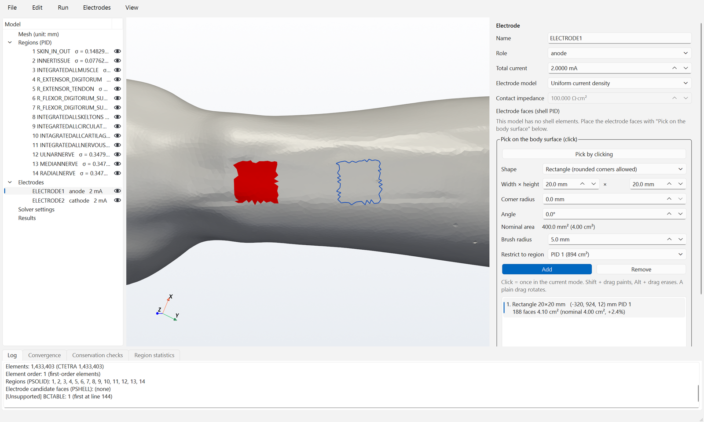
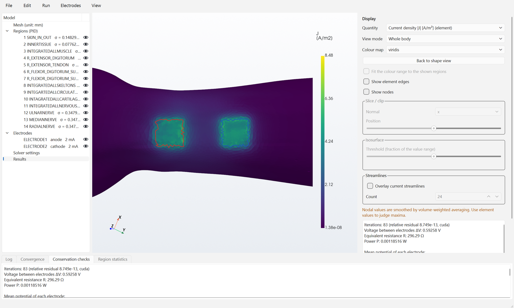
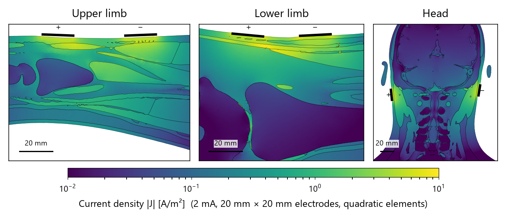

# FacetSetFEM

English | [日本語](README.ja.md)

A finite element simulator for **transcutaneous electrical stimulation**: it computes the electric
potential and current density inside the body for a given set of skin electrodes.
**Electrodes are boundary conditions on sets of body-surface element faces**, so you can place an
electrode of any shape anywhere on an anatomical model with a click in the GUI — no remeshing.



## Features

- **Place electrodes without remeshing.** Click on the body surface in the 3D view and the faces around
  that point become an electrode (circle or rounded rectangle; faces can also be painted in or out one by one).
  Meshes with electrodes already modelled as shell elements work too.
- **Reads anatomical meshes directly.** Nastran bulk data (e.g. exported from ScanIP), normalised to SI units.
  Linear and quadratic tetrahedra, hexahedra and pentahedra.
- **Two electrode models.** Uniform current density (default) and the complete electrode model with
  contact impedance, which captures current crowding at electrode edges.
- **Fast, and the same answer on every machine.** Preconditioned conjugate gradients (Jacobi or algebraic
  multigrid) on a single CPU core, all CPU cores, or a CUDA GPU — and **the three give bit-identical results**.
  A 10-million-node model solves in about 11 s on one GPU.
- **Verified against analytical solutions.** Five analytical benchmarks and mesh-convergence rates are part of the
  regression tests; current conservation and energy balance are checked automatically on every solve.
- **GUI and Python API.** Both drive the same core, so parameter studies (electrode position, conductivity,
  current) can be scripted. Results are written to VTU (ParaView), CSV, and a JSON summary with provenance
  (input hashes, Git state, timing).
- **English and Japanese user interface.**

|  |  |
|---|---|
|  |  |
| Solved current density \|J\| on the skin | \|J\| on a section through both electrodes (upper limb, lower limb, head; 2 mA, 20 mm square electrodes, quadratic elements) |

See [About the images](#about-the-images) for the source of the anatomical models.

## Installation

### From a wheel (no Rust or CUDA Toolkit needed)

```bash
pip install facetsetfem-0.1.0-cp312-abi3-win_amd64.whl
python -m facetsetfem.gui
```

The wheel works with Python 3.12 or later and pulls in the GUI dependencies (PySide6, PyVista, pyvistaqt).
Solving on a GPU needs an NVIDIA driver and a GPU of compute capability 6.0 or later; without one,
FacetSetFEM falls back to the CPU automatically. To build the wheel yourself, run
`python scripts/build_release.py` (add `--no-cuda` for a CPU-only build); it is written to `dist/`.

### From source

Requires Rust 1.97+ and Python 3.12+.

```bash
git clone https://github.com/t-ota0407/FacetSetFEM.git
cd FacetSetFEM
python -m venv .venv
.venv/Scripts/python.exe -m pip install -r requirements.txt
.venv/Scripts/maturin.exe develop --release
.venv/Scripts/python.exe -m facetsetfem.gui tests/models/slab_3layer.yaml
```

Development and testing are done on Windows 11 with the MSVC toolchain (Visual Studio Build Tools with the
C++ workload and the Windows SDK). The build succeeds without the CUDA Toolkit; the GPU is then simply not used.

## Usage

### GUI

```bash
python -m facetsetfem.gui tests/models/slab_3layer.yaml          # a case file
python -m facetsetfem.gui tests/models/slab_3layer.bdf --unit mm # a Nastran mesh (asks for the unit if omitted)
```

Nastran files carry no unit information, so FacetSetFEM never guesses the length unit: it shows the
model dimensions and asks. The interface language can be switched under *View → Language*
(or `--lang ja`).

To place an electrode on a model without shell elements, open the electrode page, press
*Pick by clicking*, and click on the skin. Restrict the pick to the skin region (PID) so that cut faces
of the model are not selected.

| Action | Effect |
|---|---|
| Click | Place one patch (centre + current shape) |
| Shift + drag | Paint faces in |
| Alt + drag | Erase faces |
| Plain drag | Rotate the view |

### Python API

```python
import facetsetfem

mesh = facetsetfem.read_nastran("tests/models/slab_3layer.bdf", length_unit="mm")
case = facetsetfem.Case(mesh)
case.set_conductivity({1: 0.10, 2: 0.04, 3: 0.35})   # sigma [S/m] per PSOLID PID
case.add_electrode("E1", role="anode",   current=2e-3, shell_pids=[101])
case.add_electrode("E2", role="cathode", current=2e-3, shell_pids=[201])

result = case.solve()
print(result)                    # <Solution iterations=95 residual=7.49e-11 R=548.5664 ohm>
print(result.impedance)          # resistance between the electrodes [ohm]
print(result.j_magnitude.max())  # max |J| [A/m^2] (element values)

for s in result.region_stats():  # per-region statistics (volume-weighted percentiles)
    print(s["name"], s["j_magnitude"]["p99"], s["hotspot"]["element_id"])

result.write_vtu("out.vtu")                 # open in ParaView
result.write_region_stats_csv("stats.csv")
result.write_summary_json("summary.json")   # with input hashes and Git state
```

Electrodes on the body surface of a model without shell elements:

```python
mesh = facetsetfem.read_nastran("head.nas", length_unit="mm")
for row in mesh.surface_pids():   # regions exposed on the outer surface, largest first
    print(row["pid"], row["n_faces"], row["area"])

case.add_electrode("E1", role="anode", current=2e-3,
                   patches=[{"center": [-0.068, 1.717, -0.028], "radius": 0.025, "pid": 51}])
case.add_electrode("E2", role="cathode", current=2e-3,
                   patches=[{"center": [-0.061, 1.652, -0.031], "shape": "rect",
                             "width": 0.02, "height": 0.02, "corner_radius": 0.002,
                             "axis": [1, 0, 0], "angle": 30, "pid": 51}])
```

Other entry points:

```python
result = facetsetfem.Study.load("tests/models/slab_3layer.yaml").solve()   # a YAML case file

# Complete electrode model (contact impedance in ohm m^2)
case.add_electrode("E1", role="anode", current=2e-3, shell_pids=[101],
                   distribution="complete_electrode", contact_impedance=0.01)

# Parameter study
study = facetsetfem.Study.load("tests/models/slab_3layer.yaml")
table = facetsetfem.sweep(study, {"sigma.2": [0.02, 0.04], "current": [1e-3, 2e-3]})
table.write_csv("sweep.csv")

# Quadratic tetrahedra (or `mesh.element_order: 2` in the case file)
mesh2 = mesh.elevate()

print(facetsetfem.describe_gpus())   # available GPUs
```

Exports for other software: `case.write_nastran("out.bdf")` writes the mesh with the electrodes as
shell elements, and `result.write_nodes_csv(...)` / `result.write_elements_csv(...)` write
unrounded nodal and element values.

> The bundled tissue conductivities (`facetsetfem.tissue("muscle")`) are representative values for getting the
> order of magnitude right, not a literature database. Check the literature for real analyses.

## Performance

The three backends give bit-identical answers; only the speed differs.
On an NVIDIA RTX A6000 and a 20-core CPU (release build, tolerance 1e-12):

| Model | Single core | All cores | GPU |
|---|---|---|---|
| 0.6 M nodes, Jacobi | 20.2 s | 4.9 s | 3.8 s |
| 10 M nodes, Jacobi | | | 23 s (1,423 iterations) |
| 10 M nodes, AMG | | | 11 s (42 iterations) |
| 10 M nodes, quadratic tetrahedra, AMG | | | 23 s (70 iterations) |

With AMG the iteration count stays at 34–49 from 40 k to 1.5 M nodes. `solver.backend: auto` picks the
parallel CPU above 20 k nodes and the GPU above 250 k nodes.

## Verification

- Five analytical benchmarks (uniform field, layered medium, concentric spherical shells, point electrode on a
  half-space, two-layer half-space) and mesh-convergence rates: potential 1.93 / field 0.87 for linear elements
  (theory 2 / 1), 2.8 / 1.9 for quadratic elements (theory 3 / 2).
- The complete electrode model against an exact series-resistance solution (relative 1e-9) and the analytical
  solution for a square electrode on a half-space (within 0.1 % after extrapolation).
- Conservation checks (current conservation, energy balance, discrete residual) on every solve, reported as warnings.

```bash
cargo test --release -- --include-ignored   # Rust: unit, integration and heavy verification tests
python -m pytest                            # Python API and GUI
```

## Documentation

- [SPEC.md](SPEC.md) — the full specification: physics, discretisation, solver design, GUI, and the
  development history (in Japanese).
- [README.ja.md](README.ja.md) — the Japanese README, with more usage details and notes for developers.

## License

[MIT License](LICENSE). Dependencies are under their own licenses (PySide6, used for the GUI, is LGPL-3.0;
it is installed as a separate package and not included in this repository).

## About the images

The upper-limb, lower-limb and head models in the images are tetrahedral meshes built in ScanIP from the
Solid 3D Male Model by Zygote Media Group (<https://www.zygote.com>).
**The models and meshes are not included in this repository.** The only bundled model is the three-layer
slab sample (`tests/models/slab_3layer.bdf`, regenerated by `scripts/make_sample_mesh.py`).
